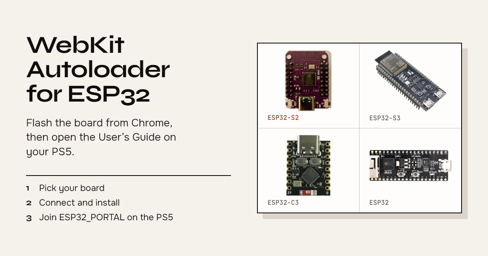

# PS5 WebKit Autoloader para ESP32

[English](README.md) · Español

[](https://percdotdev.github.io/ps5-webkit-autoloader-esp32/?lang=es)

Esto convierte una placa ESP32 barata en un punto de acceso Wi-Fi. Conectas la placa a la PS5, te unes a esa red y abres la **Guía del usuario** oficial. La guía carga una página desde la placa (no desde internet). Esa página instala [itsPLK/ps5-webkit-autoloader](https://github.com/itsPLK/ps5-webkit-autoloader). Después, **Multimedia → WebKit Autoloader** abre Payload Manager.

Úsalo en una consola tuya. El homebrew y los exploits de WebKit pueden incumplir los términos de Sony. La consola o la cuenta de PSN pueden ser baneadas si esa consola se conecta a internet. Este proyecto no te oculta de Sony.

| Exploit | Software del sistema de la PS5 |
| --- | --- |
| poops | 7.00–12.00 |
| relapse | 7.00–13.60 excepto 9.05 |

La página elige el exploit. En el Wi-Fi de la placa usa Relapse, salvo en 9.05, que solo puede usar Poops. Poops es el plan B cuando la consola no tiene interfaz de red y el firmware es 12.00 o anterior.

## Qué necesitas

- Una PS5 en una de las versiones de arriba
- Una placa ESP32 con puerto USB: **ESP32-S2 Mini** (TENSTAR y similares), ESP32-S3, ESP32-C3 o ESP32-PICO
- Un cable USB de datos, no uno que solo carga
- Chrome o Edge en un PC para grabar el firmware (Firefox y Safari no pueden)

## Graba el firmware (una sola vez)

La placa viene vacía. Le grabas nuestra imagen desde un PC. Después la pasas a la PS5.

### Flasher web

1. Abre el [flasher web](https://percdotdev.github.io/ps5-webkit-autoloader-esp32/?lang=es) en Chrome o Edge.
2. **Elige tu placa.** Los dibujos coinciden con las placas reales. El nombre viene impreso en la placa o en el anuncio de la tienda. Una TENSTAR ESP32-S2 Mini es **ESP32-S2 Mini**.
3. **Conéctala.** Mantén pulsado el botón **BOOT**, conecta la placa al PC y suéltalo tras dos segundos. Eso es el modo descarga. Sin él, el chip ignora la escritura.
4. **Instala.** Chrome te pregunta qué dispositivo usar: elige el ESP32 (un puerto COM, o “USB JTAG/serial debug unit”). No cierres la pestaña mientras escribe.

El flasher comprueba que el firmware escrito coincide con el archivo y después reinicia la placa directamente en el portal, así que no hace falta desconectarla. Si la placa no puede reiniciarse sola, la página te lo dice: pulsa **RST** o vuelve a conectarla.

Al reiniciarse puede desaparecer de Windows. Es normal. Estas imágenes apagan el USB nativo tras arrancar para que la PS5 no se pelee con el puerto serie.

También puedes descargar una [release](https://github.com/percdotdev/ps5-webkit-autoloader-esp32/releases/latest) y grabar el `.merged.bin` que toque en la dirección `0x0` con esptool. La misma versión del payload actualiza la release `latest`. Una versión nueva del payload tiene su propia release. Cada release trae un archivo `SHA256SUMS`: `sha256sum -c SHA256SUMS --ignore-missing` comprueba tu descarga.

| Placa | Archivo | LED de la placa |
| --- | --- | --- |
| ESP32-S2 | `esp32-arduino.s2.merged.bin` | GPIO 15 |
| ESP32-S3 | `esp32-arduino.s3.merged.bin` | GPIO 21 |
| ESP32-PICO | `esp32-arduino.pico.merged.bin` | GPIO 10 |
| ESP32-C3 | `esp32-arduino.c3.merged.bin` | GPIO 8 |

El LED se queda encendido mientras la placa arranca y luego da un parpadeo corto cada par de segundos cuando el punto de acceso está activo. Parpadea con cada petición de página. Si parpadea rápido, el Wi-Fi no pudo arrancar.

## Úsalo en la PS5

1. Pasa la placa del PC a un puerto USB de la PS5. Déjala ahí.
2. En la PS5: **Ajustes → Red → Ajustes → Configurar conexión a Internet**. Únete al Wi-Fi **`ESP32_PORTAL`**, contraseña **`12345678`**.
3. Quédate en esa red. La PS5 dirá que no hay internet. Es lo esperado: no hay internet y no hace falta.
4. **Ajustes → Guía y consejos → Guía del usuario**. Espera a que termine de guardar los archivos. La página lanza el exploit e instala el acceso directo en la pantalla de inicio.
5. Reinicia la PS5. Abre **Multimedia → WebKit Autoloader**. Payload Manager se abre si no tienes `autoload.txt`.

Las siguientes veces solo necesitas la placa conectada, el Wi-Fi en `ESP32_PORTAL` y luego **Multimedia → WebKit Autoloader**.

Relapse necesita la IP que da la placa (la PS5 tiene que seguir en `ESP32_PORTAL`). Poops no necesita interfaz de red.

## Compilar desde el código

```sh
./install-deps.sh
python3 pack/pack_payload.py --web /ruta/a/ps5-webkit-autoloader
make
```

Solo Arduino-ESP32 **2.0.11**. Las imágenes quedan en `build/{pico,s2,s3,c3}/`. `make debug` / `make debug-s2` mantiene el USB serie para que puedas leer los logs.

## Problemas

¿Algo falla con el flasher, la placa o `ESP32_PORTAL`? [Abre un issue](https://github.com/percdotdev/ps5-webkit-autoloader-esp32/issues/new/choose) y pega el log del flasher (Instalar → Registro → Copiar). Los problemas del payload van a [itsPLK](https://github.com/itsPLK/ps5-webkit-autoloader/issues).

## Créditos

Basado en [owendswang/ps5-webkit-autoloader-esp32](https://github.com/owendswang/ps5-webkit-autoloader-esp32). Payload: [itsPLK](https://github.com/itsPLK/ps5-webkit-autoloader). Cadenas: [slopkit](https://github.com/jordyidk/slopkit), [Relapse](https://github.com/ntfargo/Relapse-Exploit). Flasher: [esptool-js](https://github.com/espressif/esptool-js).

## Licencia

Firmware y build: MIT. Los payloads incluidos mantienen sus propios términos. Ver [LICENSE](LICENSE).
