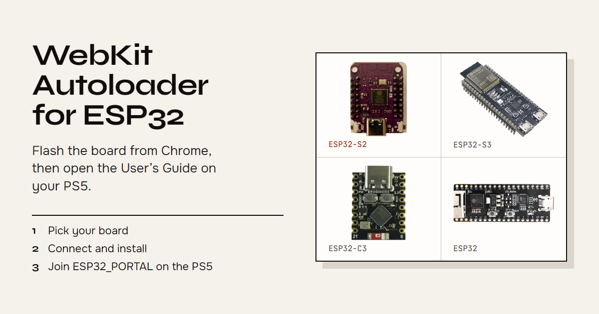

# PS5 WebKit Autoloader for ESP32

English · [Español](README.es.md)

[](https://percdotdev.github.io/ps5-webkit-autoloader-esp32/)

This turns a cheap ESP32 board into a Wi-Fi hotspot. You plug the board into the PS5, join that hotspot, and open the official **User’s Guide**. The guide loads a page from the board (not from the internet). That page installs [itsPLK/ps5-webkit-autoloader](https://github.com/itsPLK/ps5-webkit-autoloader). After that, **Media → WebKit Autoloader** starts Payload Manager.

Use it on a console you own. Homebrew and WebKit exploits can violate Sony’s terms. The console or the PSN account can be banned if that console goes online. This project does not hide you from Sony.

| Exploit | PS5 system software |
| --- | --- |
| poops | 7.00–12.00 |
| relapse | 7.00–13.60 except 9.05 |

The page picks the exploit. On this board’s Wi-Fi it uses Relapse, except on 9.05, which can only run Poops. Poops is the fallback when the console has no network interface and the firmware is 12.00 or older.

## What you need

- A PS5 on one of the versions above
- An ESP32 board with a USB port: **ESP32-S2 Mini** (TENSTAR and similar), ESP32-S3, ESP32-C3, or ESP32-PICO
- A USB cable that carries data, not charge-only
- Chrome or Edge on a PC to write the firmware (Firefox and Safari cannot)

## Write the firmware (one time)

The board ships empty. You write our image onto it from a PC. After that you move the board to the PS5.

### Web flasher

1. Open the [web flasher](https://percdotdev.github.io/ps5-webkit-autoloader-esp32/) in Chrome or Edge.
2. **Choose your board.** The drawings match the real boards. The name is printed on the board or in the shop listing. A TENSTAR ESP32-S2 Mini is **ESP32-S2 Mini**.
3. **Plug it in.** Hold the **BOOT** button, plug the board into the PC, let go after two seconds. That is download mode. Without it the chip ignores the write.
4. **Install.** Chrome asks which device to use: pick the ESP32 (a COM port, or “USB JTAG/serial debug unit”). Leave the tab open while it writes.

The flasher checks the written firmware against the file, then restarts the board straight into the portal, so there is no need to replug it. If the board cannot restart itself, the page says so: press **RST** or replug it.

When the board restarts it may vanish from Windows. That is normal. These images turn off native USB after boot so the PS5 does not fight the serial port.

You can also download a [release](https://github.com/percdotdev/ps5-webkit-autoloader-esp32/releases/latest) and write the matching `.merged.bin` at address `0x0` with esptool. The same payload version updates the `latest` release in place. A new payload version gets its own release. Each release has a `SHA256SUMS` file: `sha256sum -c SHA256SUMS --ignore-missing` checks your download.

| Board | File | On-board LED |
| --- | --- | --- |
| ESP32-S2 | `esp32-arduino.s2.merged.bin` | GPIO 15 |
| ESP32-S3 | `esp32-arduino.s3.merged.bin` | GPIO 21 |
| ESP32-PICO | `esp32-arduino.pico.merged.bin` | GPIO 10 |
| ESP32-C3 | `esp32-arduino.c3.merged.bin` | GPIO 8 |

The LED stays on while the board boots, then does a short blink every couple of seconds when the hotspot is up. It flashes on each page request. Fast blinking means the Wi-Fi hotspot failed to start.

## Use it on the PS5

1. Move the board from the PC to a USB port on the PS5. Leave it there.
2. On the PS5: **Settings → Network → Settings → Set Up Internet Connection**. Join Wi-Fi **`ESP32_PORTAL`**, password **`12345678`**.
3. Stay on that network. The PS5 will say there is no internet. That is expected. There is no internet, and none is required.
4. **Settings → Guide and Tips → User’s Guide**. Wait until caching finishes. The page runs the exploit and installs the homescreen shortcut.
5. Reboot the PS5. Open **Media → WebKit Autoloader**. Payload Manager starts when you have no `autoload.txt`.

Next time you only need the board plugged in, Wi-Fi still on `ESP32_PORTAL`, then **Media → WebKit Autoloader**.

Relapse needs the IP the board hands out (the PS5 must stay on `ESP32_PORTAL`). Poops does not need a network interface.

## Build from source

```sh
./install-deps.sh
python3 pack/pack_payload.py --web /path/to/ps5-webkit-autoloader
make
```

Arduino-ESP32 **2.0.11** only. Images land in `build/{pico,s2,s3,c3}/`. `make debug` / `make debug-s2` keeps USB serial so you can read logs.

## Problems

Something wrong with the flasher, the board or `ESP32_PORTAL`? [Open an issue](https://github.com/percdotdev/ps5-webkit-autoloader-esp32/issues/new/choose) and paste the flasher log (Install → Logs → Copy). Payload problems go to [itsPLK](https://github.com/itsPLK/ps5-webkit-autoloader/issues).

## Credits

Started from [owendswang/ps5-webkit-autoloader-esp32](https://github.com/owendswang/ps5-webkit-autoloader-esp32). Payload: [itsPLK](https://github.com/itsPLK/ps5-webkit-autoloader). Chains: [slopkit](https://github.com/jordyidk/slopkit), [Relapse](https://github.com/ntfargo/Relapse-Exploit). Flasher: [esptool-js](https://github.com/espressif/esptool-js).

## License

Firmware and build: MIT. Bundled payloads keep their own terms. See [LICENSE](LICENSE).
